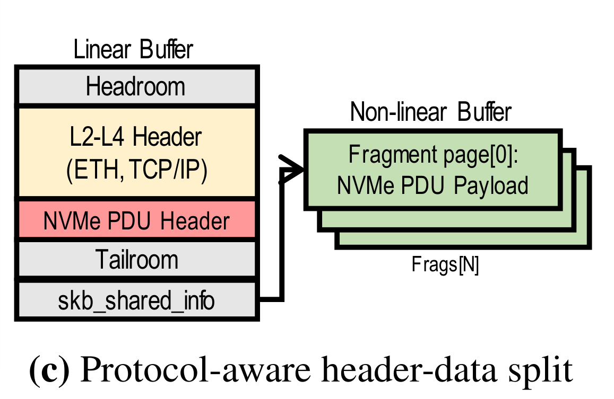

应用用直接 I/O（`O_DIRECT`）从远端 NVMe 盘读 128 KB。网卡已经通过 DMA 把数据写进本机内存，CPU 为什么还要搬一遍？因为网卡填的是网络接收页，应用等的是自己传给 `pread` 的那段地址。只要接收页开头还夹着协议头，把整页映射过去，应用看到的第一个字节就错了。

这次拷贝有多贵？Junghan Yoon 等人在 FAST 27 的 zcIO 预印本里测了原生 Linux NVMe/TCP。用 128 KB 随机读把发起端跑满，41.99% 的 CPU 周期花在复制数据上。换成同样大小的随机写，接收端是存储端，跑满时这个比例是 40.52%。zcIO 要省掉的就是这一次 CPU 拷贝，不是网卡和 SSD 的 DMA。

## 多出的 24 字节，调大 MTU 也去不掉

NVMe/TCP 把命令和数据封装成协议数据单元（PDU），再交给 TCP。一个数据 PDU 的固定头有 24 字节，后面才是磁盘数据。TCP 只负责交付有序的字节流，不保证它在哪个磁盘块的边界切段。即使网卡支持常规的头部与数据分离，它认出的也只是以太网、IP 和 TCP 头。对它来说，那 24 字节仍是数据。

假设一段里有一个 PDU 头，后面紧跟 8 KB 块数据。网卡若把 TCP 载荷从页首开始放，第一页就会装下 24 字节头和 4072 字节块数据。内核能找到这 4072 字节，却没法单独把它们映射进应用的 4 KB 页。把 MTU 调到 9000 字节，只是让这一段装得下；打开 `TCP_NODELAY`，也不会让 TCP 懂得磁盘块该在哪里切开。

## 一次 128 KB 读取，先解决怎么切，再解决往哪放

发送端先改切段规则。以 9000 字节 MTU、无可选摘要的 128 KB 数据 PDU 为例，第一段带 24 字节 PDU 头和 8 KB 块数据，余下 120 KB 分成 15 段，每段 8 KB 纯数据。首段由软件处理，后面的等长段仍可交给网卡做 TCP 分段卸载（TSO）。如果当前发送窗口只够半个块，发送端宁可先不发这半块，也不切断它。

发送端切得再准，只要网卡还把 PDU 头写进数据页，接收端就不能直接用这张页。zcIO 没有让网卡去解析 NVMe，而是借用 TCP 头里最多 40 字节的选项空间：发送首段时增大 TCP 头长度字段 `doff`，把 24 字节 PDU 头也划进 TCP 头的范围。接收网卡按这个长度分开头和数据，驱动再还原 `doff`。驱动还把 DMA 接收步长设成与页对齐的 4 KB，不让相邻小包共享同一页。这样，首段的 8 KB 块数据恰好落在两张只装块数据的页里。

图：左边保留网络头和 PDU 头，右边才是可以交出去的数据页。截自 Junghan Yoon 等人 zcIO 预印本第 7 页图 5(c)。

选项空间也会不够用。比如双向传输时，本端发数据的同时，可能还要用选择确认（SACK）告诉对端：反方向的数据有缺口，后面哪些段已经收到了。SACK 也占 TCP 选项空间。如果时间戳用了 12 字节，再放 24 字节 PDU 头就只剩 4 字节，连带一个块的 SACK 选项（10 字节）都装不下。这时只有受影响的段退回普通拷贝路径。

## 写可以交出整页，读还欠应用一次完成通知

**远程写时，接收端是存储端。** 它先记下哪些接收页可以直接用，等写请求收齐，再把这些页挂到块 I/O 请求上，让 SSD 直接从页里取数据。后端写完成前多持有一个页引用，网卡就不会提前回收这页去接下一个包。

**远程读时，接收端是发起端。** 应用已经给了目标地址，不能临时还它一个新指针。zcIO 保留原虚拟地址，把页表改为指向网卡填好的物理页。但其他 CPU 的地址转换缓存（TLB）里可能还记着旧映射，所以此时还不能向应用报告读完了。

zcIO 把一批读请求的 TLB 失效合并处理，确认旧映射失效后才发完成通知。请求稀疏时有定时器兜底；一阵 I/O 结束、队列空下来时就立即安排刷新，不等凑满一批。在作者的 3 核、24 线程实验里，4 KB I/O 花在 TLB 刷新函数上的 CPU 周期占比从逐次刷新的 15.3% 降到 3.2%。

回收也得看应用怎么用这块内存。下次读如果覆盖整页，就换入新页，把旧页交回网卡页池；如果只改半页，就保留原映射，只复制要改的部分，免得另半页的数据一起消失。应用解除映射或退出时，内核通过 `mmu_notifier` 通知 zcIO 回收相应的页。

## 67.6 GB/s 和 2.30 倍不是同一次测量

作者用两条 400 GbE 链路、ConnectX-7 网卡和 8 块 Samsung 9100 PRO SSD 跑 `fio`，路径 MTU 为 9000 字节。下表是 256 KB 随机 I/O 的吞吐量，单位都是 GB/s。15 核指**接收端**分配的核：读看发起端，写看存储端，不是两台机器合计只用 15 核。

| 15 核接收端 | Linux 6.11 | SPDK 25.09 | zcIO |
| --- | ---: | ---: | ---: |
| 随机读 | 35.0 | 39.4 | 67.6 |
| 随机写 | 24.4 | 36.3 | 56.1 |

随机读的 67.6 GB/s 是 Linux 的 1.93 倍；2.30 倍来自随机写的 56.1 对 24.4。读还要改页表、刷新 TLB，写没有这笔账。这里的 SPDK 通过 Linux TCP 套接字收数据，不能把比较结果外推到所有用户态网络栈。

把块缩到 4 KB，结论就变了：单核随机读时，Linux 和 zcIO 都是 0.9 GB/s，SPDK 是 1.8 GB/s。RocksDB 的单核点查也有类似分界。读 4 KB 值，Linux 和 zcIO 分别是每秒 9.90 万和 9.99 万次；换成 128 KB 值，分别是 1.80 万和 2.82 万次。点查要付每次请求的固定开销，复制成本却随字节数增长，值越大，省这一次复制就越划算。

我会先看接收端的 CPU 火焰图，再决定要不要试 zcIO。应用不用改接口，不等于只换一端就能用：原型需要两端配套的内核和驱动、支持头部与数据分离的网卡，以及能装下整页和协议头的端到端 MTU。原型的读侧只优化页对齐的直接 I/O，普通缓冲读的页缓存方案仍是后续工作。如果业务多是 4 KB 点查，或者热数据本来就命中页缓存，别拿那行 67.6 GB/s 给它做容量规划。

## 参考资料

- [USENIX FAST 27：zcIO 论文主页与作者](https://www.usenix.org/conference/fast27/presentation/yoon)
- [zcIO 预印本 PDF：表 1 是 CPU 剖析，图 5、7、9 分别是收包布局、吞吐量和应用实验](https://www.usenix.org/system/files/conference/fast27/fast27spring_prepub-yoon.pdf)
- [作者的 zcIO 实现与实验说明：读写两端的内核分支和硬件要求](https://github.com/TNET-SNU/zcIO)
