## 0. 本文目的

本文主要测试一下SPDK/IOUring/libaio的性能上界。

以下数据整理自 AMD 的 SPDK 26.01 NVMe BDEV 性能报告，主要使用 4 KiB I/O。结论对应文中的硬件、队列深度和工作负载，并非所有设备的通用上限。

## 1. 测试环境

**表 1：测试环境概要**

| 项目 | 配置 |
| --- | --- |
| 服务器与 CPU | Dell PowerEdge R7725xd，双路 AMD EPYC 9575F |
| 内存 | 768 GB DDR5，6400 MT/s |
| 存储 | 24 × 15.36 TB Micron 9550 PRO NVMe SSD |
| 系统 | Ubuntu 24.04.4 LTS，Linux 6.8.0-106-generic；启用 Spectre/Meltdown 缓解措施 |
| 测试软件 | SPDK 26.01，fio 3.36 |

**关键调优：** 启用 Turbo Boost 和 SMT，CPU governor 设为 `performance`，禁用 CPU/DF C-state 与 PCIe ASPM，使用 2 MiB 大页；I/O 线程绑定到 SSD 邻近的 CPU 核心。

**SSD 预处理：** 每次测试前，以 128 KiB 块顺序写满整个命名空间两遍；4 KiB 纯随机写测试先运行 60 分钟，使性能进入稳态。

## 2. 测试用例 1：SPDK NVMe BDEV 每核 IOPS 测试

**目的：** 本测试用例测量 SPDK NVMe bdev 层的最大单核 IOPS。
我们使用不同的基准测试工具（SPDK bdevperf、SPDK fio bdev 插件和 SPDK NVMe perf），以了解基准测试工具本身引入的开销。由于本测试关注每核 IOPS，因此关闭或省略了延迟测量。

使用了以下随机读/写工作负载：

- 4KiB 100% 随机读
- 4KiB 100% 随机写
- 4KiB 随机 70% 读、30% 写

对于每种工作负载，我们执行以下步骤：

1. 按“测试环境”一节所述对 SSD 进行预处理。
2. 从使用 24 块 NVMe 设备的配置开始运行每种工作负载，然后在每次后续运行中减少 SSD 数量。
   - 这展示了随着 SSD 数量增加，IOPS 如何扩展，直到达到最大每核 IOPS。
   - 从 24 块 SSD 开始并在后续运行中减少数量，可以避免在运行之间重新预处理，因为所有 SSD 都在前一次运行中处于活动状态，因此仍处于稳态。
3. 每项测试重复三次，并报告三次运行的平均值。

**表 2：SPDK NVMe BDEV IOPS 测试配置**

| 项目 | 说明 |
| --- | --- |
| 测试用例 | SPDK NVMe BDEV 每核 IOPS 测试 |
| 测试配置 | fio 版本：fio-3.36；NVMe SSD 数量：{1, 2, 3, 4, 5, …,24}；将 SPDK_BDEV_IO_CACHE_SIZE 从 256 改为 2048（使用 bdev_set_options RPC 调用）。 |

**Bdevperf 配置：**

```bash
spdk/build/examples/bdevperf -c bdev.conf -q ${iodepth} -o ${block_size} -w ${rw} -M ${rwmixread} -t 300 -m 0 -p 0
```

**fio 配置：**

```ini
[global]
ioengine=spdk_bdev
spdk_json_conf=bdev.conf
gtod_reduce=1
direct=1
thread=1
norandommap=1
time_based=1
ramp_time=60s
runtime=300s
bs=4k
numjobs=1
```

**随机读和混合工作负载：**

```ini
rw={randread, randrw}
rwmixread={100,70}
iodepth={128, 192, 256}
```

**随机写工作负载：**

```ini
rw=randwrite
rwmixread=0
iodepth={32,64,128}
```

### 2.1 SPDK NVMe BDEV 单核吞吐量

第一项测试使用 SPDK bdevperf 执行，它是一个轻量级基准测试工具，给 I/O 路径增加的延迟极小。下列图表展示了随着 NVMe SSD 数量增加，SPDK 块层的单核 IOPS 结果。

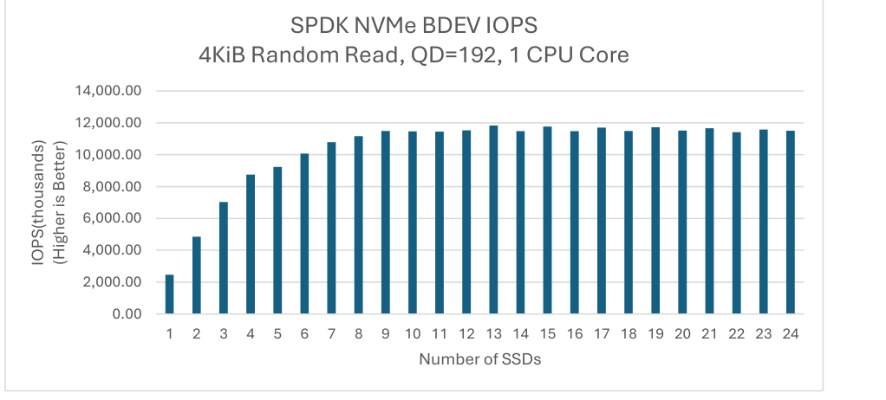

**图 1：SPDK NVMe BDEV IOPS 随 SSD 数量增加的扩展性（4KiB 随机读，1 个 CPU 核心，QD=192，使用 bdevperf 工具）**

**图示说明：**

- 标题：SPDK NVMe BDEV IOPS。
- 副标题：4KiB 随机读，QD=192，1 个 CPU 核心。
- 纵轴：IOPS（千），越高越好。
- 横轴：SSD 数量。

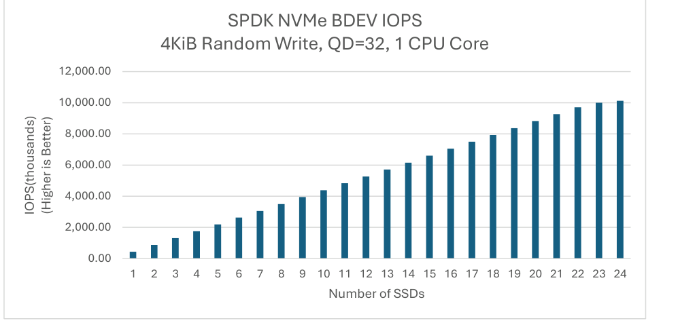

**图 2：SPDK NVMe BDEV IOPS 随 SSD 数量增加的扩展性（4KiB 随机写，1 个 CPU 核心，QD=32，使用 bdevperf 工具）**

**图示说明：**

- 标题：SPDK NVMe BDEV IOPS。
- 副标题：4KiB 随机写，QD=32，1 个 CPU 核心。
- 纵轴：IOPS（千），越高越好。
- 横轴：SSD 数量。

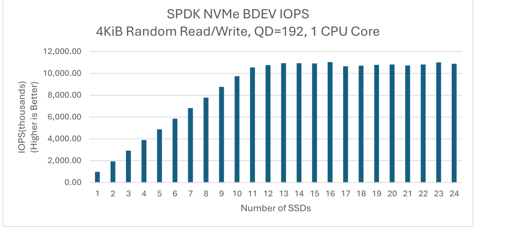

**图 3：SPDK NVMe BDEV IOPS 随 SSD 数量增加的扩展性（4KiB 70/30 随机读/写，1 个 CPU 核心，QD=192，使用 bdevperf 工具）**

**图示说明：**

- 标题：SPDK NVMe BDEV IOPS。
- 副标题：4KiB 随机读/写，QD=192，1 个 CPU 核心。
- 纵轴：IOPS（千），越高越好。
- 横轴：SSD 数量。

### 2.2 Bdevperf 与 fio 的每核 IOPS 结果对比

SPDK 提供了 bdevperf 基准测试工具，该工具仅包含定义基本工作负载和收集有限指标所需的最少功能。fio 在定义工作负载、扩展测试和收集详细性能数据方面提供了丰富得多的功能，但这种灵活性带来了更高的开销。本测试比较了 bdevperf 与使用 SPDK bdev 插件的 fio 的每核 IOPS。

**表 3：每核 IOPS 性能；SPDK fio bdev 插件与 SPDK bdevperf 对比（块大小=4KiB，1 个 CPU 核心）**

| 工作负载 | SPDK fio bdev 插件（IOPS，千） | SPDK bdevperf（IOPS，千） | 性能提升 |
| --- | ---: | ---: | ---: |
| 4KiB 随机读，QD=192，8 块 SSD | 7514.92 | 11160.33 | 48% |
| 4KiB 随机写，QD=32，24 块 SSD | 6112.99 | 10122.57 | 66% |
| 4KiB 70/30 随机读/写，QD=192，12 块 SSD | 5891.61 | 10766.84 | 83% |

当被测系统每核能够提供数百万 IOPS 时，基准测试开销就十分重要。在此环境中，开销较低的 SPDK bdevperf 工具提供的每核 IOPS 比 fio 最多高 83%。

### 2.3 NVMe BDEV 与轮询模式驱动的每核 IOPS 对比

这部分测试比较了 SPDK NVMe bdev 层与 SPDK NVMe 轮询模式驱动的吞吐量。SPDK 块层提供了额外功能，但这些功能引入了可测量的开销。对于随机读工作负载，bdev 层提供的每核 IOPS 比更底层的轮询模式驱动低约 58%。对于随机写工作负载，差距则小得多。该比较使用 SPDK bdevperf 和 nvmeperf 执行。

**表 4：SPDK NVMe Bdev 与 SPDK NVMe PMD 的每核 IOPS 对比（块大小=4KiB，1 个 CPU 核心）**

| 工作负载 | SPDK Bdevperf（IOPS，千） | SPDK Nvmeperf（IOPS，千） | 性能提升 |
| --- | ---: | ---: | ---: |
| 4KiB 随机读，QD=256，8 块 SSD | 11,467.53 | 18,115.95 | 58% |
| 4KiB 随机写，QD=32，24 块 SSD | 10,122.57 | 10,460.22 | 3% |

### 2.4 结论

1. 对于随机读工作负载，与使用 SPDK NVMe 块设备模块相比，SPDK NVMe 轮询模式驱动提供的 IOPS 高 58%。
2. 对于随机读工作负载，在 NVMe SSD 数量增加到 3 块之前，性能呈线性扩展，达到约 700 万 IOPS。在此之后，扩展变为非线性，并在使用 13 块 SSD 时达到约 1180 万 IOPS 的峰值。
3. 对于随机写工作负载，性能一直线性扩展至 24 块 NVMe SSD，达到约 1010 万 IOPS。
4. 对于 70/30 随机读/写工作负载，性能一直线性扩展至 12 块 SSD，达到约 1080 万 IOPS。

## 3. 测试用例 2：SPDK NVMe BDEV I/O 核心数扩展

**目的：** 本测试用例展示了为 I/O 处理分配更多 CPU 核心时，NVMe bdev 吞吐量如何扩展。
测试中使用的 CPU 核心数从 1 增加到 2、3、4、5、6、8、10 和 12。

**测试工作负载：**

- 4KiB 100% 随机读
- 4KiB 100% 随机写
- 4KiB 随机 70% 读、30% 写

**表 5：SPDK NVMe BDEV I/O 核心数扩展性测试**

| 项目 | 说明 |
| --- | --- |
| 测试用例 | 测试 SPDK NVMe BDEV I/O 核心数扩展性测试 |
| 测试配置 | CPU 核心数：1, 2, 3, 4, 5, 6, 8, 10, 12；NVMe SSD 数量：测试中每个 CPU 核心对应 8 块，最多 24 块 NVMe SSD；NUMA 优化：选择用于测试的 CPU 时，使其与 NVMe 驱动器在平台 NUMA 节点间的分布相匹配。 |

**Bdev perf 配置：**

```bash
spdk/build/examples/bdevperf --json bdev.conf \
    -q ${QD} -o 4096 -w randrw -M ${MIXREAD} \
    -t 300 -m ${CORE_MASK} -p ${PRIMARY_CORE}
```

### 3.1 结果

**表 6：SPDK NVMe BDEV I/O 核心数扩展性测试（QD=192 时的 4KiB 100% 随机读 IOPS；QD=32 时的 4KiB 100% 随机写 IOPS；QD=192 时的 4KiB 70/30 随机读/写 IOPS）**

IOPS 单位：千。

| CPU 核心数 | NVMe SSD 数量 | 随机读，QD=192 | 随机写，QD=32 | 70/30 随机读/写，QD=192 |
| ---: | ---: | ---: | ---: | ---: |
| 1 | 8 | 10,954.07 | 5,358.88 | 10,608.60 |
| 2 | 16 | 21,699.64 | 8,131.82 | 20,991.29 |
| 3 | 24 | 32,480.44 | 10,183.48 | 31,266.99 |
| 4 | 24 | 39,209.51 | 10,553.68 | 39,744.37 |
| 5 | 24 | 43,417.17 | 10,457.12 | 44,562.07 |
| 6 | 24 | 50,088.87 | 10,467.55 | 49,155.86 |
| 8 | 24 | 55,274.96 | 10,633.36 | 52,186.72 |
| 10 | 24 | 56,218.37 | N/A | 52,799.65 |
| 12 | 24 | 57,819.93 | N/A | 53,847.02 |

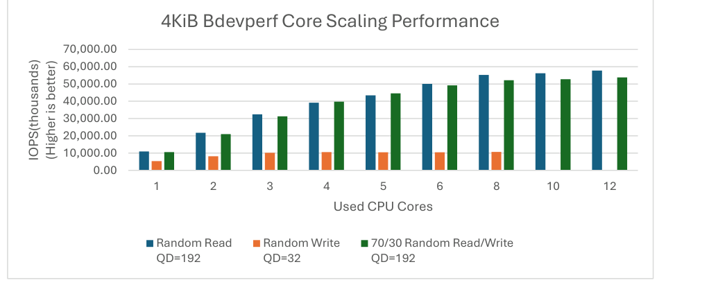

**图 4：SPDK NVMe BDEV I/O 核心数扩展性（QD=192 时的 4KiB 100% 随机读 IOPS；QD=32 时的 4KiB 100% 随机写 IOPS；QD=192 时的 4KiB 70/30 随机读/写 IOPS）**

**图示说明：**

- 标题：4KiB Bdevperf 核心数扩展性能。
- 纵轴：IOPS（千），越高越好。
- 横轴：使用的 CPU 核心数。
- 图例：随机读，QD=192；随机写，QD=32；70/30 随机读/写，QD=192。

### 3.2 结论

1. 对于 4 KiB 随机读工作负载，当 I/O 核心数增加到 3 个 CPU 核心之前，IOPS 几乎呈线性扩展。超过 3 个核心之后，扩展变为非线性，并在使用 12 个 CPU 核心时达到 5782 万 IOPS 的峰值，这接近此测试环境的理论最大值。
   - a. 当我们将 bdevperf 的 I/O 线程绑定到 SSD 邻近的本地 CPU 核心时，在 6、8 和 10 个 I/O 核心的情况下，IOPS 吞吐量提升了 5–6%。
2. 对于 4 KiB 70/30 随机读/写工作负载，IOPS 在增加到 4 个 I/O 核心之前几乎呈线性扩展。超过 4 个核心之后，扩展变为非线性，并在使用 12 个 CPU 核心时达到 5385 万 IOPS 的峰值。该结果超出了这些 NVMe SSD 在此工作负载下的预期吞吐量；我们怀疑这是由于预处理不完善所致，其影响会随时间推移逐渐消退。不过，这些结果是可重复的，仍然展示了 SPDK 在 I/O 核心数增加时的强大扩展性。
3. 对于 4 KiB 随机写工作负载，IOPS 在增加到 3 个 CPU 核心之前呈线性扩展，并达到约 1050 万 IOPS 的峰值。吞吐量受到 NVMe SSD 而非 CPU 核心的限制。因此，增加 I/O 核心并未提高 IOPS。

## 4. 测试用例 3：SPDK NVMe BDEV 延迟

本测试用例考察 SPDK NVMe bdev 层的延迟特征，并将其与 Linux 内核 NVMe 块层进行比较。我们使用 SPDK fio bdev 插件而不是 bdevperf，因为它提供更详细的延迟指标。fio 针对一块 NVMe 驱动器上的单个块设备运行了 15 分钟。目标是使用直方图和汇总指标比较延迟随时间变化的一致性。Linux 内核块层也提供 I/O 轮询，以减少上下文切换、中断传递延迟和中断处理程序调度等开销。因此，本节比较了 SPDK、Linux libaio，以及启用轮询的 Linux io_uring 的延迟。

**测试工作负载：**

- 4KiB 100% 随机读
- 4KiB 100% 随机写

**表 7：SPDK NVMe BDEV 延迟测试**

| 项目 | 说明 |
| --- | --- |
| 测试用例 | 测试 SPDK NVMe BDEV 延迟测试 |
| 测试配置 | Fio 版本：fio-3.36；CPU 核心数：1；NVMe SSD 数量：1 |
| SPDK NVMe 驱动配置 | `ioengine=spdk_bdev` |
| Linux 内核默认配置（libaio） | `ioengine=libaio` |
| Linux 内核 io_uring | `ioengine=io_uring` |

**Linux 内核 io_uring：系统 NVMe 块设备配置**

```bash
echo 0 > /sys/block/nvme0n1/queue/iostat
echo 0 > /sys/block/nvme0n1/queue/rq_affinity
echo 2 > /sys/block/nvme0n1/queue/nomerges
echo -1 > /sys/block/nvme0n1/queue/io_poll_delay
```

**fio 配置（公共部分）：**

```ini
[global]
direct=1
thread=1
time_based=1
norandommap=1
group_reporting=1

rw={randread | randwrite}
bs=4096
runtime=900
ramp_time=120
numjobs=1
log_avg_msec=15
write_lat_log=/tmp/tc3_lat.log
```

**fio 配置（SPDK 专用部分）：**

```ini
[global]

ioengine=spdk_bdev
spdk_conf=/tmp/bdev.conf

[filename0]
iodepth=1
cpus_allowed=0
filename=Nvme0n1
```

**fio 配置（Linux 内核公共部分）：**

```ini
[global]

ioengine={libaio | io_uring}

[filename0]
iodepth=1
cpus_allowed=0
filename=/dev/nvme0n1
```

**fio 配置（Linux 内核 io_uring 专用部分）：**

```ini
[global]
fixedbufs=1
hipri=1
registerfiles=1
sqthread_poll=1
```

Linux 块层在完成队列上实现 I/O 轮询。轮询能够消除上下文切换开销、IRQ 传递开销以及 IRQ 处理程序调度开销。

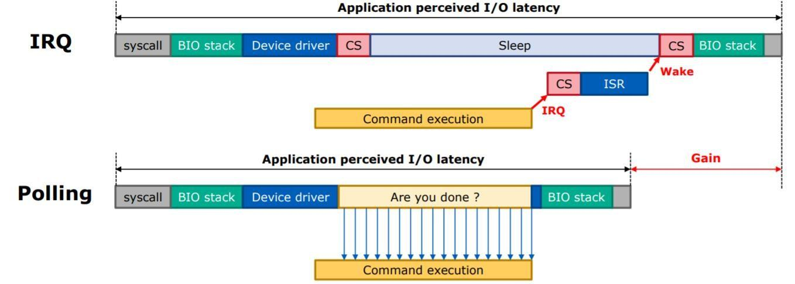

**图 5：通过轮询优化 Linux 块层 I/O。**

**图示说明：**

| 标注 | 含义 |
| --- | --- |
| IRQ | IRQ（中断请求） |
| Polling | 轮询 |
| Application perceived I/O latency | 应用程序感知到的 I/O 延迟 |
| syscall | 系统调用 |
| BIO stack | BIO 栈 |
| Device driver | 设备驱动 |
| CS | CS（上下文切换） |
| Sleep | 睡眠 |
| ISR | ISR（中断服务例程） |
| Wake | 唤醒 |
| Command execution | 命令执行 |
| Are you done ? | 完成了吗？ |
| Gain | 收益 |

此外，Linux 块 I/O 轮询提供了一种降低 CPU 负载的机制。在经典轮询模型中，CPU 自旋等待命令完成，并占用一个 CPU 核心 100% 的资源。还存在一种自适应混合轮询，它让 I/O 轮询线程睡眠约为命令执行时间一半的时长，从而降低 CPU 负载；但必须在 I/O 完成之前提前唤醒轮询线程，并预留足够的上下文切换时间。本文档的测试没有使用混合轮询模式。

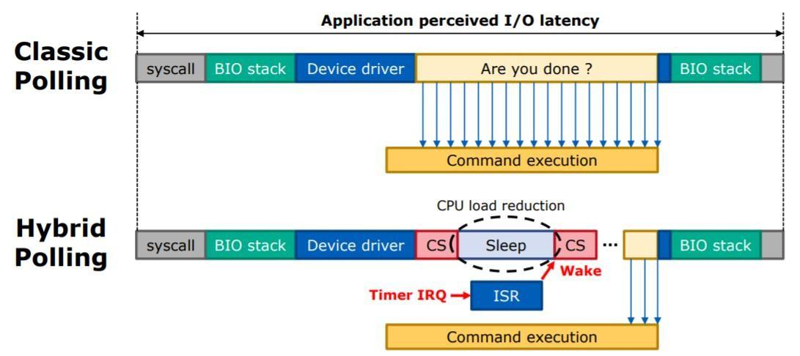

**图 6：Linux 块 I/O 经典轮询与混合轮询的延迟分解。**

**图示说明：**

| 标注 | 含义 |
| --- | --- |
| Classic Polling | 经典轮询 |
| Hybrid Polling | 混合轮询 |
| Application perceived I/O latency | 应用程序感知到的 I/O 延迟 |
| syscall | 系统调用 |
| BIO stack | BIO 栈 |
| Device driver | 设备驱动 |
| Are you done ? | 完成了吗？ |
| Command execution | 命令执行 |
| CPU load reduction | CPU 负载降低 |
| CS | CS（上下文切换） |
| Sleep | 睡眠 |
| Wake | 唤醒 |
| Timer IRQ | 定时器 IRQ |
| ISR | ISR（中断服务例程） |

表格和图表中的数据比较了使用 SPDK bdev，与使用 Linux 块层 I/O 模型 libaio 和启用轮询模式的 io_uring 执行各种 4KiB 工作负载时的 I/O 延迟。

### 4.1 平均延迟与尾延迟对比

**表 8：SPDK bdev 与 Linux 内核延迟对比（4KiB 随机读，QD=1，运行时间=900s）**

| 延迟指标（usec） | SPDK Fio BDEV 插件 | Linux 内核（libaio） | Linux 内核（io_uring） |
| --- | ---: | ---: | ---: |
| 平均值 | 58.10 | 60.29 | 58.59 |
| P90 | 66.05 | 68.10 | 67.07 |
| P99 | 67.07 | 69.12 | 68.10 |
| P99.99 | 84.14 | 83.80 | 84.14 |
| 标准差 | 5.71 | 5.76 | 5.70 |
| 平均提交延迟 | 0.09 | 0.79 | 0.00 |
| 平均完成延迟 | 58.01 | 59.50 | 58.55 |

**表 9：SPDK bdev 与 Linux 内核延迟对比（4KiB 随机写，QD=1，运行时间=900s）**

| 延迟指标（usec） | SPDK Fio BDEV 插件 | Linux 内核（libaio） | Linux 内核（io_uring） |
| --- | ---: | ---: | ---: |
| 平均值 | 9.42 | 12.07 | 10.79 |
| P90 | 9.41 | 11.54 | 10.82 |
| P99 | 10.01 | 12.18 | 11.46 |
| P99.99 | 84.48 | 87.55 | 87.55 |
| 标准差 | 1.12 | 1.36 | 1.26 |
| 平均提交延迟 | 0.11 | 0.82 | 0.00 |
| 平均完成延迟 | 9.31 | 11.25 | 10.75 |

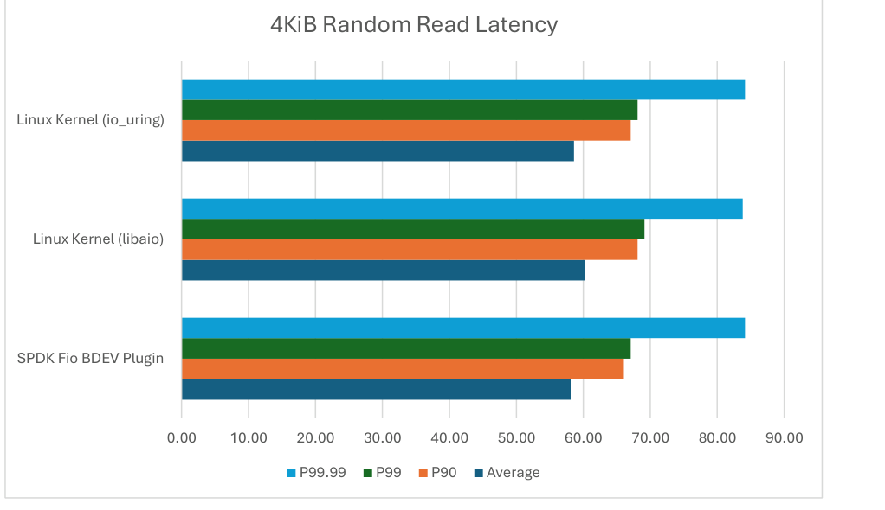

**图 7：SPDK bdev 与 Linux 内核延迟对比（4KiB 随机读）**

**图示说明：**

- 标题：4KiB 随机读延迟。
- 分类：Linux 内核（io_uring）；Linux 内核（libaio）；SPDK Fio BDEV 插件。
- 图例：P99.99；P99；P90；平均值。

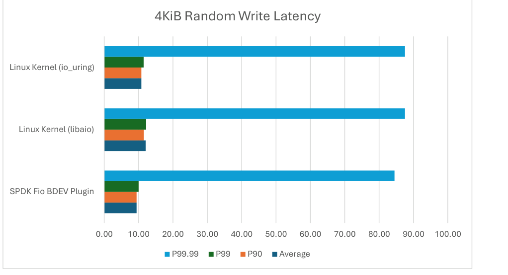

**图 8：SPDK bdev 与 Linux 内核延迟对比（4KiB 随机写）**

**图示说明：**

- 标题：4KiB 随机写延迟。
- 分类：Linux 内核（io_uring）；Linux 内核（libaio）；SPDK Fio BDEV 插件。
- 图例：P99.99；P99；P90；平均值。

### 4.2 Linux 内核 libaio 直方图

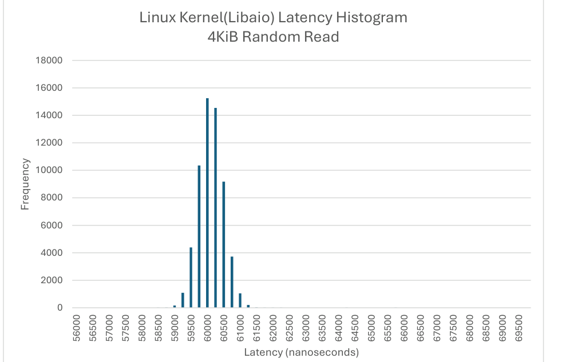

**图 9：Linux 内核（默认 libaio）4KiB 随机读平均延迟直方图（QD=1，运行时间=900s，fio，采样间隔=15msec）**

**图示说明：**

- 标题：Linux 内核（Libaio）延迟直方图。
- 副标题：4KiB 随机读。
- 纵轴：频数。
- 横轴：延迟（纳秒）。

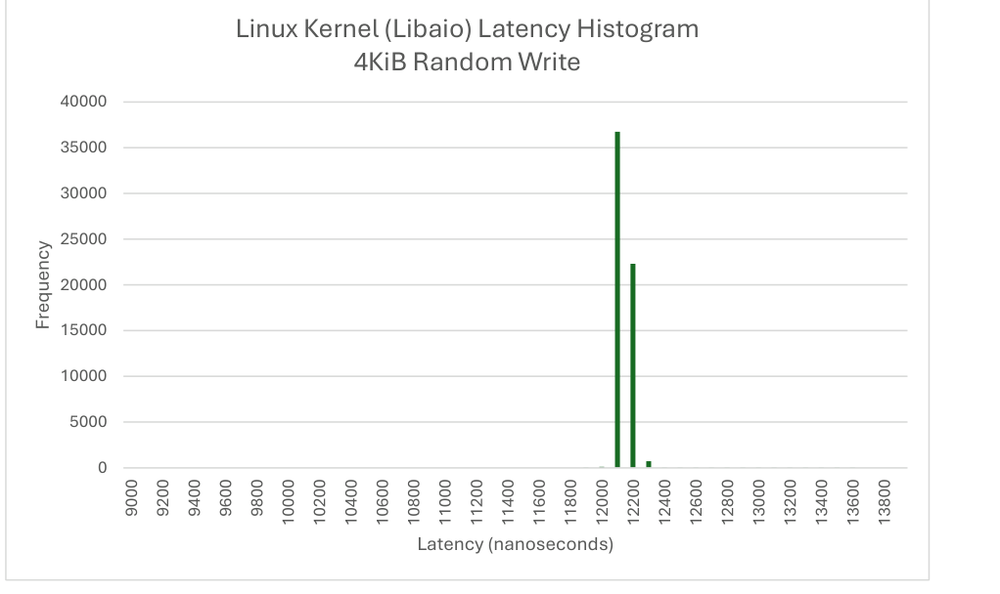

**图 10：Linux 内核（默认 libaio）4KiB 随机写平均延迟直方图（QD=1，运行时间=900s，fio，采样间隔=15msec）**

**图示说明：**

- 标题：Linux 内核（Libaio）延迟直方图。
- 副标题：4KiB 随机写。
- 纵轴：频数。
- 横轴：延迟（纳秒）。

### 4.3 Linux 内核 io_uring 直方图

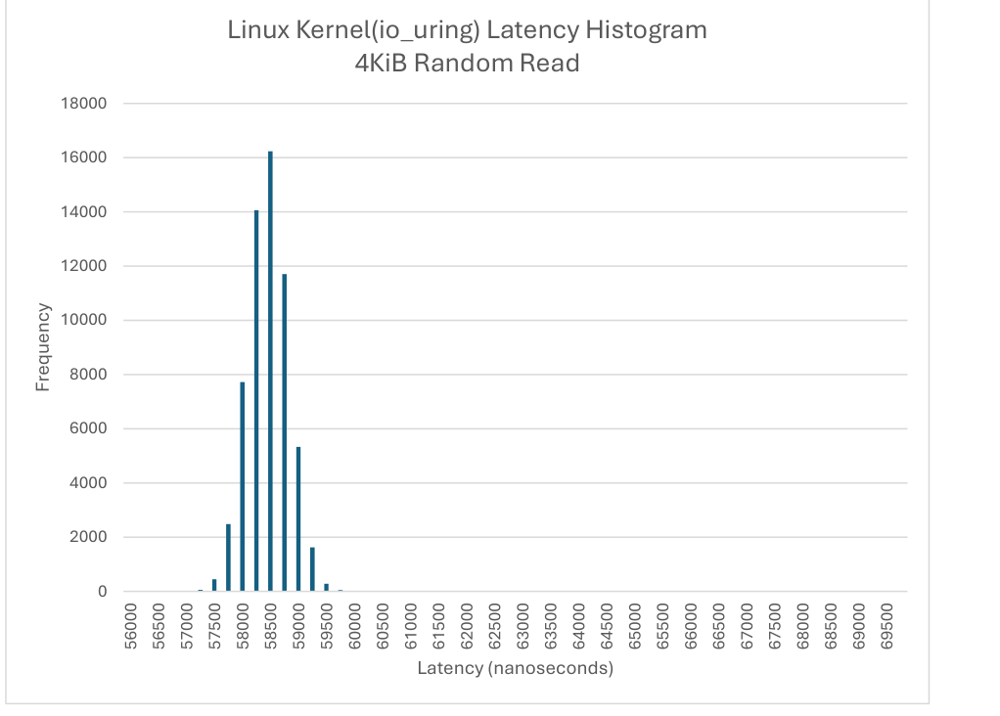

**图 11：Linux 内核（io_uring 轮询）4KiB 随机读平均延迟直方图（QD=1，运行时间=900s，fio，采样间隔=15msec）**

**图示说明：**

- 标题：Linux 内核（io_uring）延迟直方图。
- 副标题：4KiB 随机读。
- 纵轴：频数。
- 横轴：延迟（纳秒）。

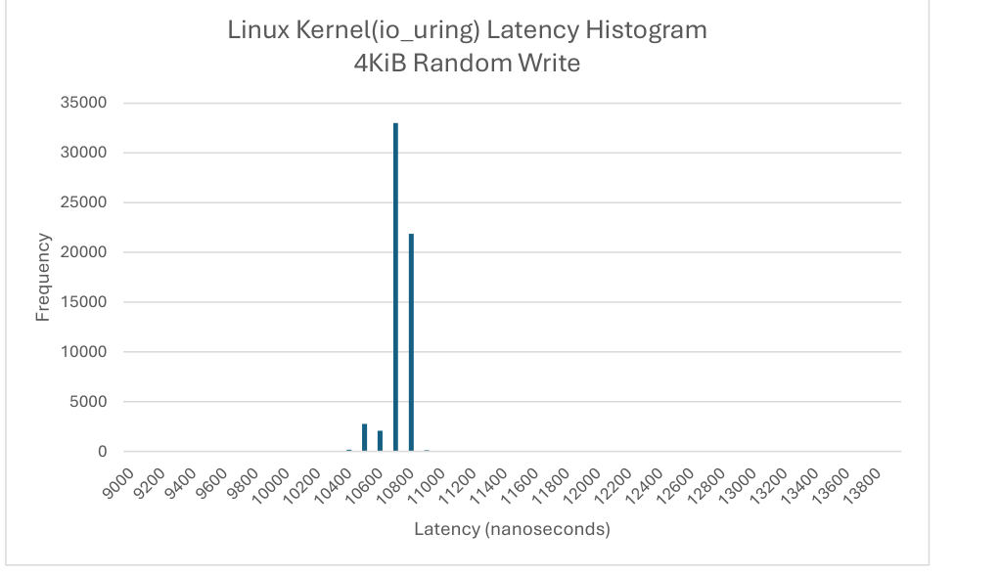

**图 12：Linux 内核（io_uring 轮询）4KiB 随机写平均延迟直方图（QD=1，运行时间=900s，fio，采样间隔=15msec）**

**图示说明：**

- 标题：Linux 内核（io_uring）延迟直方图。
- 副标题：4KiB 随机写。
- 纵轴：频数。
- 横轴：延迟（纳秒）。

### 4.4 SPDK fio Bdev 直方图

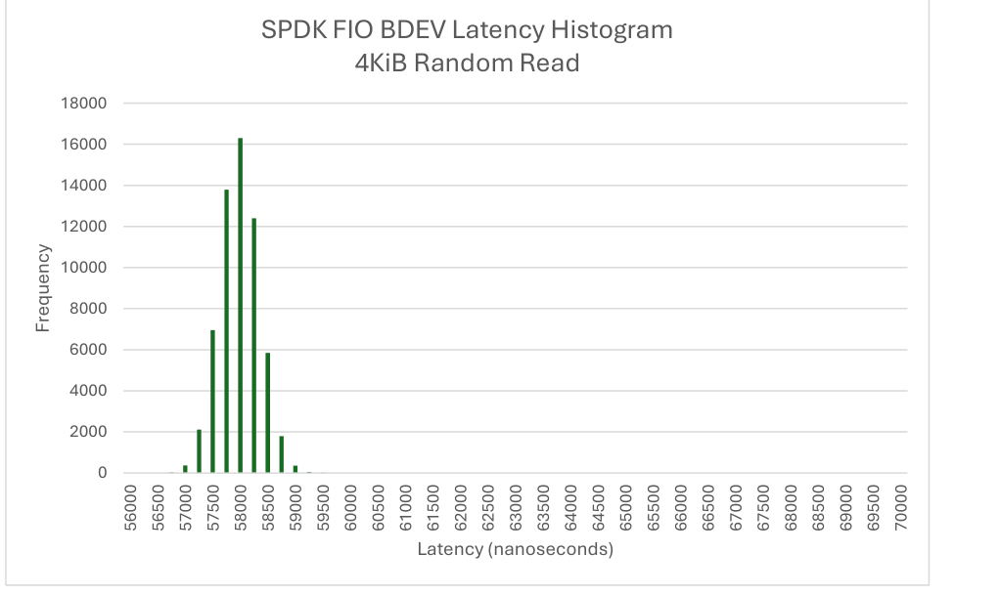

**图 13：SPDK BDEV NVMe 4KiB 随机读平均延迟直方图（QD=1，运行时间=900s，fio，采样间隔=15msec）**

**图示说明：**

- 标题：SPDK FIO BDEV 延迟直方图。
- 副标题：4KiB 随机读。
- 纵轴：频数。
- 横轴：延迟（纳秒）。

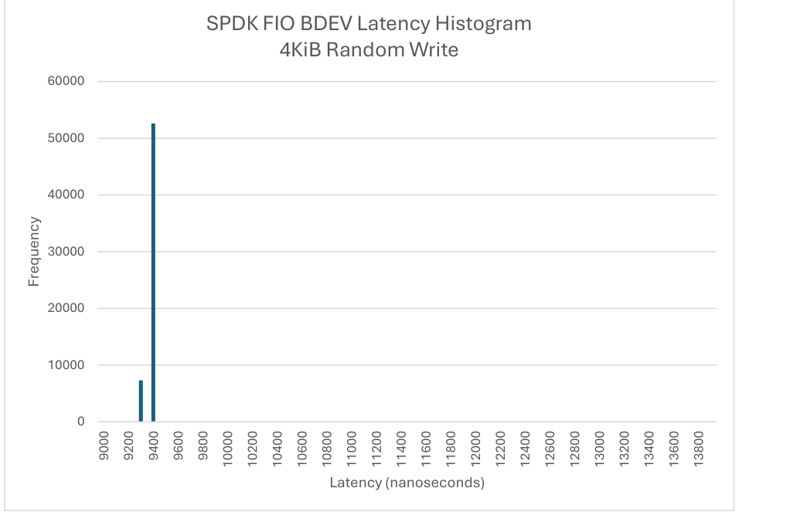

**图 14：SPDK BDEV NVMe 4KiB 随机写平均延迟直方图（QD=1，运行时间=900s，fio，采样间隔=15msec）**

**图示说明：**

- 标题：SPDK FIO BDEV 延迟直方图。
- 副标题：4KiB 随机写。
- 纵轴：频数。
- 横轴：延迟（纳秒）。

### 4.5 性能与不断增加的队列深度之间的关系

**目的：** 本节比较了在单个 NVMe SSD 上使用单个 CPU 核心、将队列深度从 1 增加到 512 时，SPDK、启用轮询的 Linux io_uring，以及 Linux libaio 的 IOPS 和平均延迟。

**表 10：队列深度增加时的性能；SPDK NVMe BDEV、Linux 默认 libaio 与 Linux io_uring 轮询对比（4KiB 随机读，1 块 NVMe SSD，1 个 CPU 核心，numjobs=1）**

| QD | SPDK IOPS | SPDK 平均延迟（usec） | Linux 内核（libaio）IOPS | Linux 内核（libaio）平均延迟（usec） | Linux 内核（io_uring 轮询）IOPS | Linux 内核（io_uring 轮询）平均延迟（usec） |
| ---: | ---: | ---: | ---: | ---: | ---: | ---: |
| 1 | 17,152 | 58 | 16,569 | 60 | 17,051 | 59 |
| 2 | 34,456 | 58 | 33,269 | 60 | 34,197 | 58 |
| 4 | 68,819 | 58 | 66,344 | 60 | 68,156 | 59 |
| 8 | 137,053 | 58 | 131,741 | 61 | 135,183 | 59 |
| 16 | 271,220 | 59 | 258,980 | 62 | 265,275 | 60 |
| 32 | 529,837 | 60 | 489,729 | 65 | 510,726 | 63 |
| 64 | 1,008,554 | 63 | 597,075 | 107 | 945,792 | 68 |
| 128 | 1,822,784 | 70 | 597,125 | 214 | 1,504,185 | 85 |
| 256 | 2,455,507 | 104 | 595,430 | 430 | 1,987,999 | 129 |
| 512 | 2,456,238 | 208 | 596,613 | 858 | 2,214,990 | 231 |

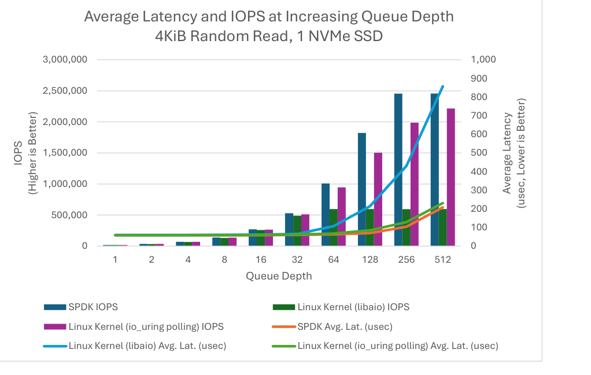

**图 15：队列深度增加时的性能；SPDK NVMe BDEV、Linux 默认 libaio 与 Linux io_uring 轮询对比（4KiB 随机读，1 块 NVMe SSD，1 个 CPU 核心，numjobs=1）**

**图示说明：**

- 标题：队列深度增加时的平均延迟和 IOPS。
- 副标题：4KiB 随机读，1 块 NVMe SSD。
- 左纵轴：IOPS，越高越好。
- 右纵轴：平均延迟（usec，越低越好）。
- 横轴：队列深度。
- 图例：SPDK IOPS；Linux 内核（libaio）IOPS；Linux 内核（io_uring 轮询）IOPS；SPDK 平均延迟（usec）；Linux 内核（libaio）平均延迟（usec）；Linux 内核（io_uring 轮询）平均延迟（usec）。

**表 11：队列深度增加时的性能；SPDK NVMe BDEV、Linux 默认 libaio 与 Linux io_uring 轮询对比（4KiB 随机写，1 块 NVMe SSD，1 个 CPU 核心，numjobs=1）**

| QD | SPDK IOPS | SPDK 平均延迟（usec） | Linux 内核（libaio）IOPS | Linux 内核（libaio）平均延迟（usec） | Linux 内核（io_uring 轮询）IOPS | Linux 内核（io_uring 轮询）平均延迟（usec） |
| ---: | ---: | ---: | ---: | ---: | ---: | ---: |
| 1 | 103,563 | 9 | 83,113 | 12 | 91,574 | 11 |
| 2 | 151,223 | 13 | 145,374 | 14 | 144,999 | 14 |
| 4 | 383,350 | 10 | 286,181 | 14 | 319,586 | 12 |
| 8 | 797,261 | 10 | 516,993 | 15 | 581,311 | 14 |
| 16 | 1,237,272 | 12 | 602,514 | 26 | 995,717 | 16 |
| 32 | 1,555,934 | 20 | 602,569 | 53 | 1,404,351 | 23 |
| 64 | 1,640,867 | 39 | 606,653 | 105 | 1,623,107 | 39 |
| 128 | 1,642,831 | 78 | 608,327 | 210 | 1,674,834 | 76 |
| 256 | 1,703,205 | 150 | 607,284 | 421 | 1,685,945 | 152 |
| 512 | 1,708,936 | 299 | 600,026 | 853 | 1,698,960 | 301 |

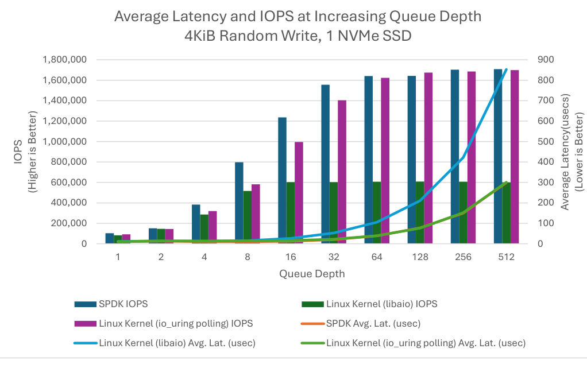

**图 16：队列深度增加时的性能；SPDK NVMe BDEV、Linux 默认 libaio 与 Linux io_uring 轮询对比（4KiB 随机写，1 块 NVMe SSD，1 个 CPU 核心，numjobs=1）**

**图示说明：**

- 标题：队列深度增加时的平均延迟和 IOPS。
- 副标题：4KiB 随机写，1 块 NVMe SSD。
- 左纵轴：IOPS，越高越好。
- 右纵轴：平均延迟（usecs），越低越好。
- 横轴：队列深度。
- 图例：SPDK IOPS；Linux 内核（libaio）IOPS；Linux 内核（io_uring 轮询）IOPS；SPDK 平均延迟（usec）；Linux 内核（libaio）平均延迟（usec）；Linux 内核（io_uring 轮询）平均延迟（usec）。

### 4.6 结论

1. 通过轮询完成事件而不是依赖中断，同时降低了延迟和延迟变化。
2. 对于随机读和随机写，SPDK NVMe Bdev 的平均延迟分别比 Linux 内核 libaio 最多低 3.63% 和 21.98%。
3. 对于随机读和随机写工作负载，SPDK NVMe Bdev 的平均延迟分别比 Linux 内核 io_uring 最多低约 0.83% 和 12.75%。
4. 对于 QD=1 的 4KiB 随机写工作负载，频数分桶非常窄，因此决定以 100ns 作为 x 轴的区间单位来呈现结果。
5. 对于 4 KiB 随机读工作负载，三种引擎在 QD 增加到 32 之前都呈线性扩展。在此之后：
   - a. SPDK NVMe bdev 的扩展在 QD=128 时变为非线性，并在 QD=256 时达到峰值，约为 246 万 IOPS，使 NVMe 驱动器饱和。
   - b. 内核 io_uring 的扩展在 QD=128 时变为非线性，并在 QD=512 时达到约 221 万 IOPS，接近使 NVMe 驱动器饱和。
   - c. 内核 libaio 在 QD=64 时达到约 597k IOPS 的峰值。超过该点后继续增加队列深度，并未提高吞吐量。
6. 对于 4 KiB 随机写工作负载，libaio 在 QD 增加到 8 之前呈线性扩展，之后仅略有增加，最终在约 608k IOPS 时使 CPU 核心饱和。io_uring 和 SPDK 在 QD 增加到 16 之前呈线性扩展。超过这些点之后，随着 NVMe 驱动器在约 170 万 IOPS 时接近饱和，扩展变为非线性。
7. 随机写工作负载的结果超过了该 NVMe SSD 的能力（约 437K IOPS），这可能是由不完善的预处理过程造成的，其影响会随时间推移逐渐消退。不过，这些结果是可重复的，并展示了 SPDK 随队列深度增加而具备的高扩展性。

## 5. 测试用例 4：不同队列深度下的 IOPS 与延迟

**目的：** 执行本测试用例是为了了解运行 SPDK 与内核 NVMe 块层时，不同队列深度下吞吐量与延迟之间的权衡。

表中的结果表示 SPDK 和 Linux 内核 NVMe 块层的 IOPS 性能和平均延迟。我们限制 SPDK 和 Linux NVMe 块层使用相同数量的 CPU 核心。

**测试工作负载：**

- 4KiB 100% 随机读
- 4KiB 100% 随机写
- 4KiB 随机 70% 读、30% 写

**表 12：不同队列深度下的 SPDK NVMe BDEV 延迟测试配置**

| 项目 | 说明 |
| --- | --- |
| 测试用例 | 测试不同队列深度下的 SPDK NVMe BDEV 延迟测试 |
| 测试配置 | fio 版本：fio-3.36；CPU 核心数：12；NVMe SSD 数量：24 |

**Linux 内核 io_uring NVMe 块设备配置：**

```bash
echo 0 > /sys/block/nvme0n1/queue/iostat
echo 0 > /sys/block/nvme0n1/queue/rq_affinity
echo 2 > /sys/block/nvme0n1/queue/nomerges
echo -1 > /sys/block/nvme0n1/queue/io_poll_delay
```

**fio 配置（公共部分）：**

```ini
[global]
direct=1
thread=1
time_based=1
norandommap=1
group_reporting=1

rw={randread | randwrite | randrw}
rwmixread={100 | 0 | 70}
bs=4096
runtime=240
ramp_time=60
numjobs=1
```

**fio 配置（SPDK 专用部分）：**

```ini
[global] ioengine=spdk_bdev
spdk_conf=/tmp/bdev.conf

[filename0]
iodepth={2, 4, 8, 16, 32, 64, 128, 256, 512, 1024}*
cpus_allowed=0
filename=Nvme0n1
filename=Nvme1n1

[filename1]
iodepth={2, 4, 8, 16, 32, 64, 128, 256, 512, 1024}*
cpus_allowed=1
filename=Nvme2n1
filename=Nvme3n1
[…]

[filename11]
iodepth={2, 4, 8, 16, 32, 64, 128, 256, 512, 1024}*
cpus_allowed=11
filename=Nvme20n1
filename=Nvme21n1
```

\* —— 测试中实际使用的 `iodepth` 参数值；该值乘以作业节中 `filename` 对象的数量，以实现所需的每块 NVMe SSD 队列深度（例如，此处 QD=256 表示每块 SSD 的 QD=128）。

**fio 配置（Linux 内核公共部分）：**

```ini
[global]
ioengine={libaio | io_uring}

[filename0]
iodepth={2, 4, 8, 16, 32, 64, 128, 256, 512, 1024}*
cpus_allowed=0
filename=/dev/nvme0n1
filename=/dev/nvme1n1

[filename1]
iodepth={2, 4, 8, 16, 32, 64, 128, 256, 512, 1024}*
cpus_allowed=1
filename=/dev/nvme2n1
filename=/dev/nvme3n1
[…]

[filename11]
iodepth={2, 4, 8, 16, 32, 64, 128, 256, 512, 1024}*
cpus_allowed=11
filename=/dev/nvme20n1
filename=/dev/nvme21n1
```

\* —— 测试中实际使用的 `iodepth` 参数值；该值乘以作业节中 `filename` 对象的数量，以实现所需的每块 NVMe SSD 队列深度（例如，此处 QD=256 表示每块 SSD 的 QD=128）。

**fio 配置（Linux 内核 io_uring 专用部分）：**

```ini
[global]
fixedbufs=1
hipri=1
registerfiles=1
sqthread_poll=1
```

### 5.1 4KiB 随机读结果

**表 13：队列深度增加时的性能；SPDK NVMe BDEV、Linux 默认 libaio 与 Linux io_uring 轮询对比（4KiB 随机读，24 块 NVMe SSD，12 个 CPU 核心）**

| QD | SPDK IOPS（百万） | SPDK 平均延迟（usec） | Linux 内核（libaio）IOPS（百万） | Linux 内核（libaio）平均延迟（usec） | Linux 内核（io_uring 轮询）IOPS（百万） | Linux 内核（io_uring 轮询）平均延迟（usec） |
| ---: | ---: | ---: | ---: | ---: | ---: | ---: |
| 1 | 0.41 | 58.17 | 0.40 | 60.57 | 0.40 | 59.50 |
| 2 | 0.83 | 57.87 | 0.79 | 60.46 | 0.81 | 59.34 |
| 4 | 1.65 | 57.93 | 1.57 | 60.90 | 1.60 | 59.74 |
| 8 | 3.29 | 58.20 | 3.10 | 61.85 | 3.17 | 60.32 |
| 16 | 6.49 | 58.85 | 5.78 | 66.25 | 6.10 | 62.75 |
| 32 | 12.64 | 60.39 | 6.56 | 116.96 | 10.78 | 71.09 |
| 64 | 23.78 | 63.96 | 6.55 | 234.31 | 15.84 | 96.85 |
| 128 | 41.70 | 72.24 | 6.55 | 468.89 | 18.94 | 162.11 |
| 256 | 52.27 | 114.02 | 6.54 | 938.99 | 23.26 | 264.07 |
| 512 | 50.61 | 238.70 | 6.58 | 1,867.14 | 21.83 | 562.79 |

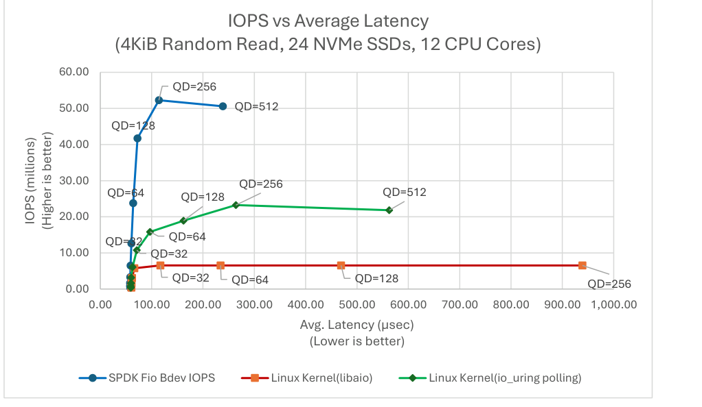

**图 17：队列深度增加时的性能；SPDK NVMe BDEV、Linux 默认 libaio 与 Linux io_uring 轮询对比（4KiB 随机读，24 块 NVMe SSD，12 个 CPU 核心）**

**图示说明：**

- 标题：IOPS 与平均延迟。
- 副标题：4KiB 随机读，24 块 NVMe SSD，12 个 CPU 核心。
- 纵轴：IOPS（百万），越高越好。
- 横轴：平均延迟（µsec），越低越好。
- 图例：SPDK Fio Bdev IOPS；Linux 内核（libaio）；Linux 内核（io_uring 轮询）。
- 数据点标注：QD=32、QD=64、QD=128、QD=256、QD=512；即对应的队列深度。

### 5.2 4KiB 随机写结果

**表 14：队列深度增加时的性能；SPDK NVMe BDEV、Linux 默认 libaio 与 Linux io_uring 轮询对比（4KiB 随机写，24 块 NVMe SSD，12 个 CPU 核心）**

| QD | SPDK IOPS（百万） | SPDK 平均延迟（usec） | Linux 内核（libaio）IOPS（百万） | Linux 内核（libaio）平均延迟（usec） | Linux 内核（io_uring 轮询）IOPS（百万） | Linux 内核（io_uring 轮询）平均延迟（usec） |
| ---: | ---: | ---: | ---: | ---: | ---: | ---: |
| 1 | 2.46 | 9.52 | 1.83 | 12.99 | 2.13 | 11.09 |
| 2 | 3.63 | 12.98 | 3.41 | 13.95 | 3.44 | 13.76 |
| 4 | 8.60 | 10.88 | 6.06 | 15.66 | 6.81 | 13.91 |
| 8 | 15.90 | 11.53 | 6.43 | 29.68 | 11.08 | 17.18 |
| 16 | 25.07 | 14.44 | 6.44 | 59.46 | 13.98 | 27.36 |
| 32 | 30.88 | 23.39 | 6.44 | 119.06 | 16.38 | 46.76 |
| 64 | 33.09 | 44.85 | 6.47 | 237.22 | 17.48 | 87.76 |
| 128 | 34.98 | 85.94 | 6.45 | 476.23 | 18.42 | 166.69 |
| 256 | 36.99 | 163.76 | 6.45 | 952.59 | 18.08 | 340.00 |
| 512 | 36.17 | 323.39 | 6.32 | 1,944.09 | 15.96 | 769.84 |

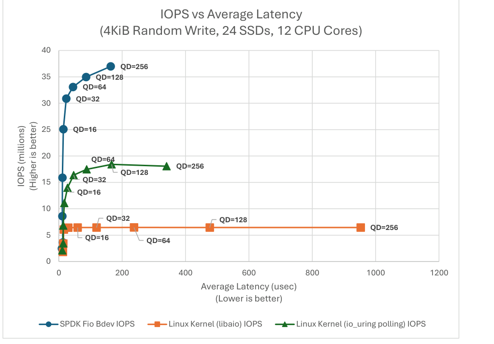

**图 18：队列深度增加时的性能；SPDK NVMe BDEV、Linux 默认 libaio 与 Linux io_uring 轮询对比（4KiB 随机写，24 块 NVMe SSD，12 个 CPU 核心）。**

**图示说明：**

- 标题：IOPS 与平均延迟。
- 副标题：4KiB 随机写，24 块 SSD，12 个 CPU 核心。
- 纵轴：IOPS（百万），越高越好。
- 横轴：平均延迟（usec），越低越好。
- 图例：SPDK Fio Bdev IOPS；Linux 内核（libaio）IOPS；Linux 内核（io_uring 轮询）IOPS。
- 数据点标注：QD=16、QD=32、QD=64、QD=128、QD=256；即对应的队列深度。

### 5.3 4KiB 随机 70%/30% 读/写结果

**表 15：队列深度增加时的性能；SPDK NVMe BDEV、Linux 默认 libaio 与 Linux io_uring 轮询对比（4KiB 70/30 随机读/写，24 块 NVMe SSD，12 个 CPU 核心）**

| QD | SPDK IOPS（百万） | SPDK 平均延迟（usec） | Linux 内核（libaio）IOPS（百万） | Linux 内核（libaio）平均延迟（usec） | Linux 内核（io_uring 轮询）IOPS（百万） | Linux 内核（io_uring 轮询）平均延迟（usec） |
| ---: | ---: | ---: | ---: | ---: | ---: | ---: |
| 1 | 0.54 | 43.98 | 0.52 | 46.42 | 0.53 | 45.36 |
| 2 | 1.06 | 44.96 | 1.01 | 47.40 | 1.03 | 46.26 |
| 4 | 2.04 | 46.84 | 1.93 | 49.72 | 1.97 | 48.49 |
| 8 | 3.83 | 49.85 | 3.48 | 54.97 | 3.64 | 52.57 |
| 16 | 7.02 | 54.41 | 5.82 | 65.78 | 6.27 | 61.04 |
| 32 | 12.26 | 62.26 | 6.39 | 119.96 | 9.08 | 84.44 |
| 64 | 19.29 | 79.00 | 6.37 | 240.83 | 11.66 | 131.54 |
| 128 | 29.52 | 102.91 | 6.36 | 482.84 | 14.65 | 209.63 |
| 256 | 37.36 | 160.87 | 6.39 | 961.79 | 17.56 | 349.88 |
| 512 | 40.15 | 301.00 | 6.38 | 1,925.52 | 16.97 | 724.06 |

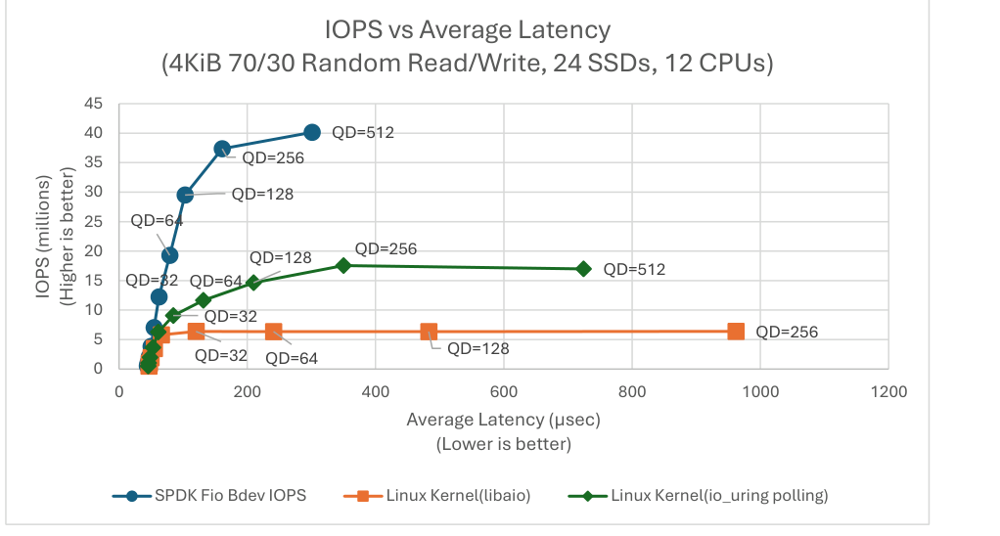

**图 19：队列深度增加时的性能；SPDK NVMe BDEV、Linux 默认 libaio 与 Linux io_uring 轮询对比（4KiB 70/30 随机读/写，24 块 NVMe SSD，12 个 CPU 核心）**

**图示说明：**

- 标题：IOPS 与平均延迟。
- 副标题：4KiB 70/30 随机读/写，24 块 SSD，12 个 CPU。
- 纵轴：IOPS（百万），越高越好。
- 横轴：平均延迟（µsec），越低越好。
- 图例：SPDK Fio Bdev IOPS；Linux 内核（libaio）；Linux 内核（io_uring 轮询）。
- 数据点标注：QD=32、QD=64、QD=128、QD=256、QD=512；即对应的队列深度。

### 5.4 结论

1. 对于随机读工作负载，SPDK NVMe BDEV fio 插件在 QD=256 时达到最高约 5227 万 IOPS。这低于测试用例 2 中使用 bdevperf 测得的 5782 万 IOPS，因为这项基于 fio 的测试被限制为使用 12 个 CPU 核心。
2. 对于 4 KiB 随机写工作负载，SPDK NVMe bdev fio 插件的 IOPS 在 QD 增加到 8 之前几乎呈线性扩展。超过该点之后，扩展变为非线性，并在 QD=256 时达到 3699 万 IOPS 的峰值。
   - i. Linux io_uring 的 IOPS 在 QD 增加到 8 之前也几乎呈线性扩展。超过该点之后，扩展变为非线性，并在 QD=128 时达到 1842 万 IOPS 的峰值；在此之后，随着队列深度进一步增加，性能开始下降。
   - ii. Linux libaio 的 IOPS 在 QD 增加到 4 之前几乎呈线性扩展，达到 606 万 IOPS。超过 QD=4 之后，收益很小，性能在 QD=64 时达到 647 万 IOPS 的峰值。
3. 对于 4 KiB 70/30 随机读/写工作负载，SPDK NVMe bdev fio 插件在 QD=512 时达到最高 4015 万 IOPS。这低于测试用例 2 中使用 bdevperf 测得的约 5300 万 IOPS，而且该工作负载在所测试的队列深度范围内尚未达到峰值 IOPS。我们怀疑增加 I/O 核心可能会提高 IOPS。
4. 随机写工作负载的结果超出了这 24 块 NVMe SSD 的能力（约 1060 万 IOPS），这可能是由不完善的预处理过程造成的，其影响会随时间推移逐渐消退。不过，这些结果是可重复的，仍然展示了 SPDK 随 I/O 请求增加而具备的高扩展性。
5. Linux libaio 使用 12 个 CPU 核心达到最高约 650 万 IOPS，并未使平台的 NVMe 吞吐量饱和。随机读在 QD=32 时、随机写在 QD=8 时、70/30 随机读/写工作负载在 QD=32 时达到峰值性能。超过这些队列深度之后，IOPS 没有提高，但延迟增加了。
6. Linux io_uring 的峰值性能为：随机读在 QD=256 时达到 2326 万 IOPS，随机写在 QD=128 时达到 1842 万 IOPS，70/30 随机读/写工作负载在 QD=256 时达到 1756 万 IOPS。测试期间，htop 显示 io_uring 总共使用了 24 个 CPU 核心：12 个用于 fio，12 个用于提交队列轮询。因此，我们测得 io_uring 的每核 IOPS 最高约为 97 万，而 SPDK NVMe bdev fio 插件的每核 IOPS 最高约为 436 万。《提交队列轮询》博客进一步介绍了 io_uring 如何在此模式下消除系统调用。

## 6. 总结

1. 使用 SPDK bdevperf 基准测试工具的 SPDK NVMe BDEV 块层，在启用 Turbo Boost 的单个 AMD EPYC™ 9575F CPU 核心上，最多可提供 1180 万 IOPS。
2. SPDK NVMe BDEV 的 IOPS 仅使用 6 个 CPU 核心就可扩展至 5009 万，使用 12 个 CPU 核心时最高可达 5782 万（启用 Turbo Boost 的 AMD EPYC™ 9575F CPU 核心）。
3. 对于 4KiB 小块，SPDK NVMe BDEV 在 QD=1 时的延迟低于 Linux 内核 NVMe 块层。
   - a. 与 Linux libaio 相比，SPDK bdev 的随机读延迟最多低 3.63%，随机写延迟最多低 21.98%。
   - b. 与 Linux io_uring 相比，SPDK bdev 的随机读延迟约低 0.83%，随机写延迟约低 12.75%。
4. SPDK NVMe BDEV Fio 在队列深度为 256、使用 12 个 CPU 核心时，最高达到 5227 万 IOPS，平均延迟约为 114 usec。在相同的 fio 工作负载下，Linux io_uring 实际使用 24 个核心（12 个 fio 线程加 12 个提交队列轮询线程）时，最高达到 2326 万 IOPS，而 Linux libaio 最高达到 658 万 IOPS。

## 7. SPDK 块设备层简介

### 7.1 SPDK 轮询模式驱动

NVMe PCIe 驱动通常是操作系统内核的一部分，应用程序通过系统调用与之交互。SPDK 采用了不同的方法：它将 NVMe 设备从内核 NVMe 驱动解绑，转而将其绑定到用户态 NVMe 驱动。这使用户态应用程序能够直接访问设备及其队列。

SPDK NVMe 驱动是一个可以直接链接到应用程序中的 C 库，用于与 NVMe SSD 之间进行直接、零拷贝的数据传输。它是完全被动的：不创建任何线程，仅在响应应用程序的函数调用时执行工作。该库通过将 PCI BAR 映射到本地进程并执行 MMIO 操作来控制 NVMe 设备。SPDK NVMe 驱动也是异步的。它将 I/O 请求作为一个 NVMe 提交队列条目提交，并在命令完成之前立即返回。随后，应用程序必须对每个具有未完成 I/O 的队列对轮询完成事件，才能接收到完成回调。

### 7.2 SPDK 块设备层

SPDK 还以用户态库的形式提供完整的块存储栈，执行许多与操作系统块存储栈相同的功能。SPDK 块设备层通常称为 bdev，是一个 C 库，旨在成为传统内核存储栈中位于设备驱动之上的块存储层的用户态等价实现。

bdev 模块提供了一个抽象层，为不同类型的块存储设备提供通用 API。应用程序可以使用这些 API 枚举并认领 SPDK 块设备，然后执行读、写和 unmap 等异步 I/O 操作，而无须知道底层设备是本地 NVMe SSD、Ceph RBD 设备，还是由 malloc 内存支持的 RAM 磁盘。SPDK NVMe bdev 模块既可以为本地 PCIe 连接的 NVMe 设备创建块设备，也可以为通过 NVMe-oF 导出的远程设备创建块设备。

在本报告中，我们对本地 PCIe 连接的 NVMe 设备所使用的 bdev 层的性能与效率进行了基准测试。我们还通过多种工作负载展示了 SPDK 方法的优势，包括用户态轮询、异步 I/O，以及减少上下文切换开销。

### 7.3 FIO 集成

SPDK 提供了一个 fio 插件，用于与 Flexible I/O 基准测试工具集成。为本地连接的 PCIe NVMe bdev 生成配置文件的最快方法，是使用 `gen_nvme.sh` 脚本及其 `--json-with-subsystems` 选项，如图 20 所示。

```text
[user@localhost spdk]$ sudo scripts/gen_nvme.sh --json-withsubsystems | jq
{
  "subsystems": [
    {
      "subsystem": "bdev",
      "config": [
        {
          "method": "bdev_set_options",
          "params": {
            "bdev_io_pool_size": 65535,
            "bdev_io_cache_size": 2048,
            "bdev_auto_examine": true
          }
        },
        {
          "method": "bdev_nvme_attach_controller",
          "params": {
            "trtype": "PCIe",
            "name": "Nvme0",
            "traddr": "0000:1a:00.0"
          }
        },
        [...]
        {
          "method": "bdev_nvme_attach_controller",
          "params": {
            "trtype": "PCIe",
            "name": "Nvme23",
            "traddr": "0000:df:00.0"
          }
        }
      ]
    }
  ]
```

**图 20：NVMe bdev 配置文件示例**

通过设置 `ioengine=spdk_bdev`，并添加值指向 NVMe bdev 配置文件的 `spdk_json_conf` 参数，将 SPDK bdev 加入 fio 作业文件。

图 21 中的 fio 配置文件示例展示了如何定义多个 fio 作业，并为每个作业分配 NVMe bdev。每个作业还绑定到一个 CPU 核心，该核心与该作业将访问的 NVMe SSD 位于同一个 NUMA 节点上。

最后，要使用 bdev fio 插件，请在运行 fio 时指定 `LD_PRELOAD`。

```text
LD_PRELOAD=<path to spdk repo>/build/fio/spdk_bdev fio <fio job file>
```

占位符说明：`<path to spdk repo>` 为“SPDK 仓库路径”；`<fio job file>` 为“fio 作业文件”。

```ini
[global]
direct=1
thread=1
time_based=1
norandommap=1
group_reporting=1
ioengine=spdk_bdev
spdk_json_conf=/tmp/bdev.conf
rw=randread
rwmixread=70
bs=4096
numjobs=1
runtime=300
ramp_time=60

[filename0]
iodepth=192
cpus_allowed=16
filename=Nvme0n1
filename=Nvme4n1
filename=Nvme8n1
filename=Nvme12n1
filename=Nvme16n1
filename=Nvme20n1

[filename1]
iodepth=192
cpus_allowed=32
filename=Nvme1n1
filename=Nvme5n1
filename=Nvme9n1
filename=Nvme13n1
filename=Nvme17n1
filename=Nvme21n1

[filename2]
iodepth=192
cpus_allowed=80
filename=Nvme2n1
filename=Nvme10n1
filename=Nvme11n1
filename=Nvme14n1
filename=Nvme18n1
filename=Nvme22n1

[filename3]
iodepth=192
cpus_allowed=112
filename=Nvme3n1
filename=Nvme7n1
filename=Nvme11n1
filename=Nvme15n1
filename=Nvme19n1
filename=Nvme23n1
```

**图 21：SPDK Fio BDEV 配置文件示例**

## 参考资料

- [SPDK 26.01 NVMe BDEV 性能报告（AMD；本文性能数据与图表来源）](https://review.spdk.io/download/performance-reports/SPDK_nvme_bdev_perf_report_amd_2601.pdf)
- [SPDK 官方性能报告目录](https://spdk.io/doc/performance_reports.html)
- Damien Le Moal，《通过轮询优化 I/O 延迟》（“I/O Latency Optimization with Polling”），Vault——Linux 存储与文件系统会议——2017，2017 年 5 月 22 日；图 5、图 6 的原理示意来源。
